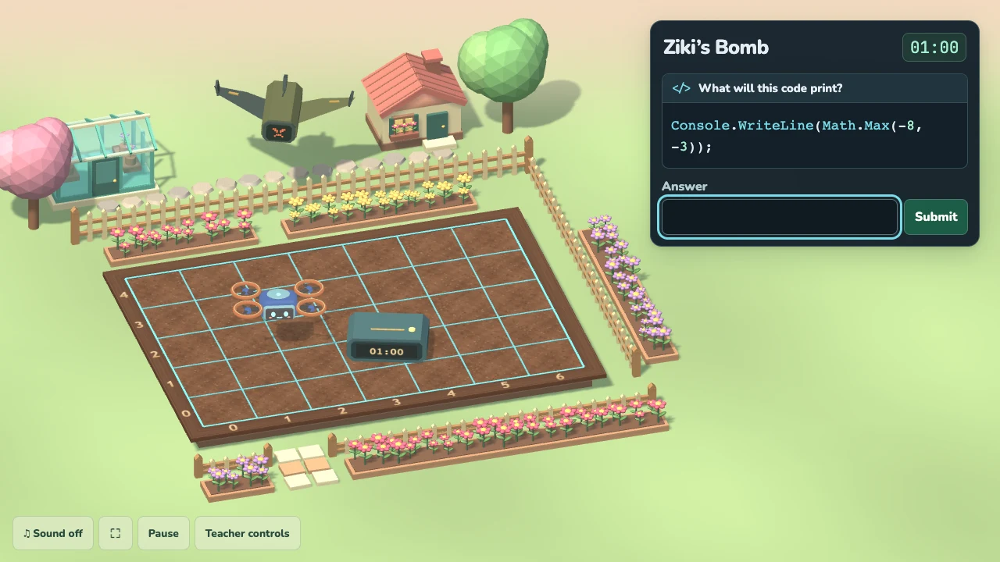

# Ziki’s Bomb

A Grade 10 C# classroom game in the setting of Ziki’s Garden. The teacher can introduce the premise aloud on the ready screen. Press **Start round** when the class is ready. Students have 60 seconds to predict what one C# expression prints. A wrong number deducts 10 seconds.

The bank has 16 questions on `Math.Abs`, `Math.Round`, `Math.Min`, `Math.Max`, `Math.Pow`, and `Math.Sqrt`. Choose **Mixed** or one method on the ready screen. **Show solution** opens the answer and explanation after a round, and **Next round** keeps the selected topic.



## Run locally

Requires Node.js 22.18+ and npm.

```sh
npm ci
npm run dev
```

Open the loopback URL printed by Vite. For a classroom rehearsal, run `npm run build` and `npm run preview`. The HTML timer and quiz also work with the static garden view if WebGL or the 3D assets are unavailable.

## Teach offline

Install dependencies and build before disconnecting. For a classroom computer without npm, copy the full `dist/` folder and serve it from a Python 3 terminal.

```sh
python3 -m http.server 4173 --bind 127.0.0.1 --directory dist
```

Open `http://127.0.0.1:4173`. On Windows with the Python launcher, replace `python3` with `py`. Keep the server open during play. All fonts, models, and effects are local. See the [teacher guide](docs/teacher.md) for controls and discussion notes.

## Maintain

Copied from C# Bomb at `b502932c4114b2167c8573008b9d4600140a1784`. This workspace has independent source and assets. The question bank is in `src/puzzles.ts`. The [asset credits](public/assets/ATTRIBUTION.md) identify the Garden art and runtime notices.

```sh
npm test
npm run test:oracle      # Requires the .NET 10 SDK
npm run validate:asset
npm run build
npm run test:browser     # Uses installed Google Chrome and a loopback server
```
