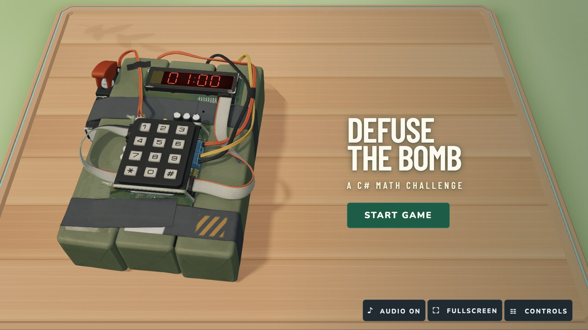
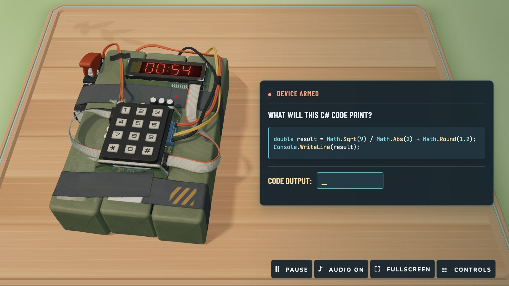
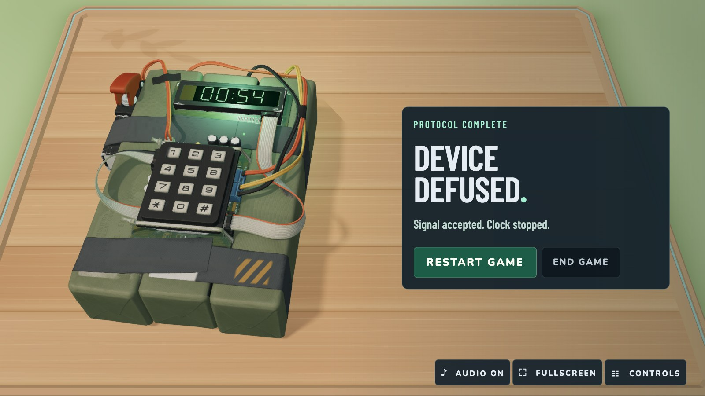

<div align="center">

# Defuse the Bomb

**One minute. One C# expression. Defuse the device.**

A Grade 10 classroom coding challenge adapted from C# Bomb (revision `b502932c4114b2167c8573008b9d4600140a1784`) and built with **Babylon.js, TypeScript, and Vite**.

</div>



<p align="center">
  <a href="docs/images/gameplay.jpg"></a>
  <a href="docs/images/defused.jpg"></a>
</p>

## The challenge

Read the two C# statements, work out what they print, and enter the output before the **60-second countdown** reaches zero. A wrong answer costs **10 seconds**. A correct answer stops the clock and defuses the device.

Sixteen puzzles cover `Math.Abs`, `Math.Round`, `Math.Min`, `Math.Max`, `Math.Pow`, and `Math.Sqrt`, with a different puzzle on each restart. The first line calculates a value with three Math calls. The second line prints that value. Most rounds include arithmetic between calls or inside a method argument. The teacher can tell the story aloud on the title screen and show the worked explanation after a failed round.

- Detailed 3D device with a live countdown display, keypad feedback and responsive lighting.
- Recorded device cues, synthesized ambience, fullscreen and teacher controls.
- A nonviolent failure sequence: fade to black, silence, then **MISSION FAILED**.
- Runs locally in a desktop browser with bundled assets and no backend.

## Run locally

From the repository root, use **Node.js 22.18+** and npm.

```sh
npm ci
npm run dev
```

Open [localhost:5173](http://127.0.0.1:5173/). For a production preview, run `npm run build`, then `npm run preview`, and open the URL printed in the terminal. Serve the game over HTTP; opening `index.html` directly will not work.

For offline use, install and build in advance, then serve the complete `dist/` directory locally. For example, run `python3 -m http.server 4173 --bind 127.0.0.1 --directory dist` and open [localhost:4173](http://127.0.0.1:4173/).

## Controls

| Key | Action |
|---|---|
| Digits / numpad, minus, decimal point, Backspace | Edit the answer |
| Enter | Submit |
| Shift P | Pause / resume |
| T | Teacher controls |
| F / M | Fullscreen / mute |
| R | Reveal the answer after failure |
| Shift R | Restart from an outcome |
| Escape | Close controls or exit fullscreen |

The [teacher guide](docs/teacher.md) has classroom instructions and a rounding discussion prompt. On-screen buttons provide the same actions. Opening teacher controls pauses an active round; closing them leaves it paused until Resume. **Switching tabs or windows keeps the countdown running.** Reduced-motion preferences soften flashes and remove camera jolts.

## Development

```sh
npm test                 # Unit tests
npm run build            # Typecheck and production build
npm run test:oracle      # Verify Math outputs with the .NET 10 SDK
npm run validate:asset   # Validate the bundled model
npm run test:browser     # Browser regressions; build first
```

Browser tests use an installed copy of **Google Chrome**. The oracle also requires the **.NET 10 SDK**. Generated reports and captures go to `test-results/`. To change the challenge pool, edit `src/puzzles.ts`; round timing is configured in `src/game.ts`.

[Verification notes](docs/verification.md) · [Asset maintenance](docs/ASSET_INSPECTION.md) · [Asset credits](public/assets/ATTRIBUTION.md)

## Distribution

The production build uses relative asset paths so it can run at a site root or under a repository path such as `/zikisbomb/`. The output includes `THIRD_PARTY_NOTICES.txt` for bundled dependencies.

The project owner has confirmed permission to redistribute the bundled model and three recordings. See the [asset attribution](public/assets/ATTRIBUTION.md) for the rights confirmation, source records, and font licenses. A project-wide software license is still to be selected if others should have permission to reuse the source.
